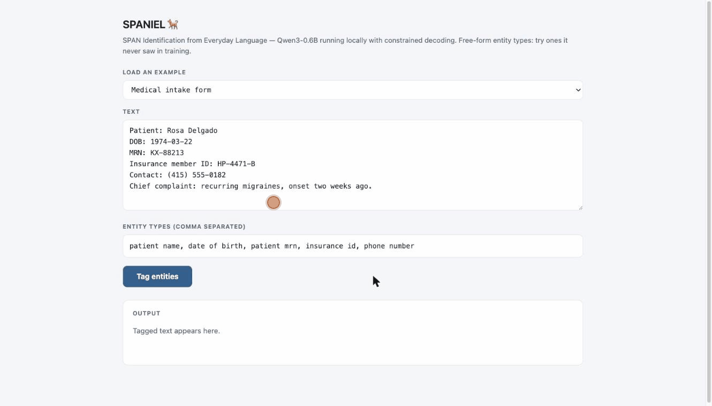

<p align="center">
  
</p>

# SPANIEL — Local PII Detection for AI Prompts

**AI governance and AI security research by [Harsh Singhal](https://www.linkedin.com/in/harshsinghal/): fine-tuning small language models to identify sensitive information before it is shared with AI services.**

SPANIEL (*SPAN Identification from Everyday Language*) is a 0.6B-parameter model for local personally identifiable information (PII) detection and named entity recognition. Give it text and natural-language entity types; it marks matching spans in the original text. The supported constrained decoder preserves the source exactly in completed outputs.

The project connects **LLM fine-tuning, synthetic training data, evaluation, and local inference** to a practical data governance question: what information is present in a prompt before an application sends it to another system?

**Current release:** an English PII annotation model, local API, and a [Python governed-retrieval example](docs/governed-retrieval.md). The example inspects text inside a retrieval tool and returns `content: null` when a configured policy matches or inspection fails. Automatic redaction and broader confidential-topic detection remain development goals; annotation alone does not remove sensitive content.

[Model on Hugging Face](https://huggingface.co/Harsh/qwen3-0.6b-pii-sft-v2) · [Try locally](#try-it-the-demo-app) · [Governed retrieval](docs/governed-retrieval.md) · [Results](#results) · [Training data and evaluation](docs/training-data-and-evaluation.md) · [Research journal](#the-journey-as-blog-entries)

## Current research milestone: credentials and contextual compensation

The next milestone develops **local sensitive-content detection that depends on context**: credentials versus placeholders and public identifiers; private pay or negotiation ranges versus public job advertisements; informal conversation and noisy transcript text. A salary range can be sensitive even without a person's name, while a private conversation can simply quote public information.

The [coverage audit](docs/coverage-audit.md) examined all 389,521 v2 training rows and used embeddings, cluster inspection and corpus retrieval to identify gaps. The [credential and compensation experiment](docs/milestones/2026-10-21-credential-context.md) adds 5,248 synthetic training examples, separate scenario-family evaluation splits, validated PII replay, a LoRA training recipe and a common constrained evaluator. **Training and candidate results are in progress; these preparation artifacts do not establish an accuracy gain.**

The project distinguishes measured capabilities from experimental and best-effort behavior. Credentials are the first area of deeper investment; broader legal, layoff and review confidentiality remain research targets. Transcript examples are simulated text, not a real audio benchmark.

[Capability and evidence record](CAPABILITIES.md) · [Progress and releases](CHANGELOG.md) · [Experiment protocol](experiments/credential-context-protocol.json)

An [initial GLiNER2.5 baseline](docs/gliner-context-baseline.md) uses the same frozen concept scenarios with fixed label-only and policy-description configurations. It reports sensitive-document recall, benign false blocks and exact spans separately. This compares an off-the-shelf encoder with the new task-specific experiment; it does not establish architecture superiority.

## Why local sensitive-data detection matters

Prompts can include personal records, customer details, employee information, and credentials. Retrieved passages and tool outputs can introduce the same information even when the user's original question contains none of it. A local detector lets an application inspect that content within its own environment.

SPANIEL supplies detection for a governance workflow. The Python example implements the retrieval-tool portion:

```text
Prompt, retrieved context, or tool output
                  |
          Local SPANIEL inspection       [available]
                  |
      Configured entity policy          [retrieval example]
                  |
      Return text or withhold           [retrieval example]
```

The model identifies spans; the application decides what to do with them. A name is not automatically prohibited information, and finding no spans is not proof that a document is safe to share. Useful deployment evidence includes missed sensitive items, false alerts on benign text, latency, and behavior when inference fails.

The research focus is to make those decisions assessable: document the data, measure generalization, preserve exact evidence, and state where the detector can fail.

## What SPANIEL does

- **Natural-language entity requests:** request labels such as `person name`, `email`, or `patient mrn`, rather than selecting only from a fixed output classifier.
- **Local inference:** run the model on your own machine or server. The demo processes submitted text locally; installation and initial model provisioning require downloads.
- **Source-preserving annotation:** the copy-or-tag decoder restricts output to source text and the requested tags. The server rejects incomplete constrained output.
- **Published evaluation:** separate results for original labels, adjudicated labels, and unfamiliar entity names.
- **Inspectible fine-tuning:** dataset converters, a seeded mixture builder, annotation guidelines, training scripts, evaluation code, and source revisions.

Example request:

```text
Entity types:
- person name
- patient mrn

Text:
Patient Brian Weaver (MRN BX-40912) called about his appointment.
```

Illustrative output:

```text
Patient <person name>Brian Weaver</person name> (MRN <patient mrn>BX-40912</patient mrn>) called about his appointment.
```

The tags locate evidence; the original values are still present. Detection accuracy is learned and imperfect. Copy fidelity is a separate property enforced by the decoder, not a guarantee supplied by the model weights alone.



## Try it: the demo app

Run the published CPU image, binding the service to your machine's loopback interface:

```bash
docker run --rm -p 127.0.0.1:8377:8377 \
  -v spaniel-models:/models ghcr.io/harshsinghal/spaniel
# Open http://127.0.0.1:8377
```

The approximately 1.2 GB model downloads on first start and is cached in the named volume. The demo includes 15 examples covering forms, logs, medical records, transcripts, invoices, and prose. Published CPU paragraph timings are approximately 10–30 seconds; they are not an interactive-latency or throughput guarantee.

The image installs CPU-only PyTorch on all platforms. Adding `--gpus all` does not make this image CUDA-enabled. For hardware acceleration, run from source with an appropriate PyTorch installation.

### Call the constrained local API

With the server running, this Python example uses only the standard library:

```python
import json
from urllib.request import Request, urlopen

payload = {
    "text": "Reach Anita at anita@example.com.",
    "entities": ["person name", "email"],
    "constrained": True,
}
request = Request(
    "http://127.0.0.1:8377/api/tag",
    data=json.dumps(payload).encode("utf-8"),
    headers={"Content-Type": "application/json"},
    method="POST",
)
with urlopen(request, timeout=120) as response:
    result = json.load(response)

if not result["constrained"] or not result["faithful"]:
    raise RuntimeError("No complete source-preserving annotation was returned")
print(result["tagged"])
```

`faithful` means the source text was preserved, not that every sensitive span was found. Treat HTTP errors and timeouts as inspection failures; an integrating application must define its response to them.

<details>
<summary>Run from source</summary>

```bash
git clone https://github.com/harshsinghal/SPANIEL.git
cd SPANIEL
python3 -m venv .venv
.venv/bin/pip install torch -r requirements-demo.txt
PII_MODEL_ID=Harsh/qwen3-0.6b-pii-sft-v2 \
PII_MODEL_REVISION=a58063469be8c7b929016d944d8d6d1545bc70a0 \
PII_MODEL_CACHE=./models \
  .venv/bin/python -m uvicorn server:app --app-dir pii_tagger \
  --host 127.0.0.1 --port 8377
```

For CUDA, install the suitable PyTorch build before the demo requirements. The source server selects CUDA, then Apple MPS, then CPU when available. Production integrations need their own authentication, access controls, and request/log retention policy.

</details>

## Protect a Python retrieval tool

The [governed-retrieval example](docs/governed-retrieval.md) reads a local text document, calls SPANIEL, validates the annotation, and returns the original text only when no requested entity is detected. Matches and inspection failures return null content with a reason. Policy and detector settings are fixed by the application, outside the agent's tool arguments.

```python
from spaniel_guard import CREDENTIALS, make_document_tool

read_document = make_document_tool(
    root="examples/governed_retrieval/documents", policy=CREDENTIALS,
)
result = read_document("sensitive_password.txt")
```

Start the local service above, then try benign, sensitive, ambiguous, and error cases:

```bash
python3 examples/governed_retrieval/demo.py benign_public.txt
python3 examples/governed_retrieval/demo.py --suite --report /tmp/spaniel-retrieval-results.json
```

The suite reports missed sensitive content, false blocks, and inspection failures separately. It uses small synthetic examples, not a general accuracy benchmark. The [integration guide](docs/governed-retrieval.md#agent-registration-and-mcp-exposure) explains Python agent registration and MCP exposure; no agent configuration is installed automatically. Enforcement tests run without model weights as part of `make test`.

**Boundary:** a policy rejection returns no document content through this tool response. A missed detection can still release sensitive content, and alternate readers or shell tools need their own controls.

## Fine-tuning with NVIDIA Nemotron-PII and a synthetic data mixture

Harsh Singhal developed SPANIEL's data preparation, fine-tuning experiments, constrained decoder, and evaluation workflow. Version 2 fine-tunes **Qwen3-0.6B with full-parameter supervised fine-tuning (SFT)** using a recorded mixture of **389,521 training examples**.

| Source | Approximate mixture share | Purpose in SPANIEL | Published dataset license |
|---|---:|---|---|
| [Gravitee PII Detection](https://huggingface.co/datasets/gravitee-io/pii-detection-dataset) | 44.6% | Broad PII coverage and varied text formats | Apache-2.0; upstream sources are documented separately |
| [NVIDIA Nemotron-PII](https://huggingface.co/datasets/nvidia/Nemotron-PII) | 25.7% | Fine-grained synthetic PII/PHI spans; deterministic date-label correction | CC BY 4.0 |
| [Ai4Privacy OpenPII 1.5M](https://huggingface.co/datasets/ai4privacy/pii-masking-openpii-1.5m) | 28.2% | English examples from an additional synthetic corpus | CC BY 4.0, credited to Ai4Privacy / Ai Suisse SA |
| Project-generated synthetic documents | 1.5% after 3× sampling | 1,966 documents targeting gaps in JSON logs, checkbox forms, and prose | Artifact is not distributed in this repository |

NVIDIA's dataset supplies synthetic records with detailed span annotations. SPANIEL uses its training partition in the mixture and a subset of its test partition for the reported evaluations. Public source availability, synthetic generation, and downstream accuracy are distinct properties; synthetic data still requires label review and evaluation on the deployment domain.

The training design includes approximately 22 natural-language aliases per label, requests containing absent labels, subsets of requested types, and optional definition conditioning. These teach the model both what to select and when to leave text untagged. The pipeline preserves each source's label vocabulary in the request, corrects specified date-family inconsistencies, filters incompatible spans, and constructs source-preserving targets.

The recorded v2 run used bf16, a 3,072-token sequence limit, effective batch size 32, a cosine learning-rate schedule starting at `1e-5`, and one epoch on an H100 NVL (approximately 11 hours of training).

See [Training data, attribution, and evaluation](docs/training-data-and-evaluation.md) for exact source revisions, modifications, upstream credits, reproducibility limits, and the distinction between the published four-source run and the available three-source rebuild.

## Results

**Strict typed span exact-match F1 on 300 held-out documents, using constrained decoding.** These are the published July 2026 experiments; this documentation update does not report a new benchmark.

| Model | Original gold | Adjudicated gold | Unseen entity names |
|---|---:|---:|---:|
| gpt-oss-120b, prompted zero-shot | 0.580 | — | — |
| SPANIEL v1, 0.6B | 0.944 | 0.924 | 0.747 |
| **SPANIEL v2, 0.6B** | **0.930** | **0.918** | **0.864** |

- V2 improves unfamiliar-name F1 by **11.7 percentage points** relative to v1. Multiple training changes were made together; this does not isolate the contribution of aliases or any individual dataset.
- Adjudicated gold was corrected and human-spot-checked. It is not a wholly independently human-annotated benchmark.
- Unseen names test new wording for entity types; they do not establish arbitrary unseen-concept understanding.
- The 120B result is an end-to-end tagged-regeneration comparison: 141/300 rows drifted or were malformed. Its F1 on parseable rows was 0.891. This is not evidence that SPANIEL generally outperforms a 120B model.
- Completed constrained outputs had 0.0% reported copy drift and malformed output. Incomplete output is a failure. Source fidelity does not measure sensitive-data recall.

The [evaluation notes](docs/training-data-and-evaluation.md#evaluation-and-interpretation) explain these boundaries. Before deploying a data protection control, measure per-category recall, benign false-alert rates, document coverage, and latency on representative inputs.

## Limitations and deployment scope

- **English intended scope:** no validated multilingual performance claim. The coverage audit found non-English records with English source metadata, so metadata filtering is not proof every training text is English.
- **Personal-attribute semantics:** current guidelines target information about people or their records. General world-fact mentions may intentionally remain untagged. See [annotation rules](guidelines_v2.md).
- **Paraphrase limits:** unfamiliar wording far from the training distribution can fail. Requesting a type does not establish that the model can recognize it reliably.
- **Output structure:** the current decoder handles non-overlapping contiguous spans and requires at least two characters per entity. Nested and linked discontinuous evidence are research goals.
- **Coverage:** broad categories such as confidential strategy, layoff discussions, or performance reviews are not validated capabilities of this PII checkpoint. It is not a prompt-injection detector or a complete DLP system.
- **Privacy boundary:** local inspection avoids sending submitted text to a hosted detector in the provided demo. Deployment networking, logs, subsequent AI calls, and access control determine the application's wider privacy boundary.

## The journey, as blog entries

The journal records the experiments as they happened, including historical headlines, costs, and negative results. The current results section above gives the scope of the comparisons.

| Research note | What it documents |
|---|---|
| [Coverage audit and data gaps](docs/coverage-audit.md) | Full-mixture inspection, embedding clusters, repeated credentials and missing supervision |
| [Credentials and contextual compensation](docs/milestones/2026-10-21-credential-context.md) | Contrastive data, transcript cases, validation and the next fine-tuning experiment |
| [Fine-tuning a small model for tagged extraction](journal/2026-07-08-tagged-regeneration-recipe.md) | Training representation, label conditioning, and early size comparisons |
| [Attribute versus mention semantics](journal/2026-07-09-attribute-vs-mention-semantics.md) | How annotation choices define what counts as PII |
| [Making copy drift unrepresentable](journal/2026-07-12-constrained-decoding.md) | The copy-or-tag automaton, tokenizer handling, and decoding bugs |
| [Auditing annotation quality](journal/2026-07-18-ten-dollar-audit.md) | Evaluation-label errors and adjudication |
| [The v2 training mixture and generalization](journal/2026-07-19-v2-generalization.md) | Four sources, wider queries, and the unseen-name result |
| [Thinking-mode experiments and negative results](journal/2026-07-21-thinking-negative-result.md) | Reasoning experiments and the limits observed at small model sizes |

## Reproducing

Install the data dependencies in a virtual environment and build a three-source variant:

```bash
python3 -m venv .venv
.venv/bin/pip install -r requirements-data.txt
.venv/bin/python build_sft_dataset.py --outdir sft_data
.venv/bin/python convert_ai4privacy.py \
  --split train --out pii_xml/ai4privacy_en.jsonl
.venv/bin/python build_sft_dataset_v2.py --skip-synth --outdir sft_data_v2
```

For the original four-source mixture, supply the 1,966-document `pii_xml/synth_docs.jsonl` artifact and omit `--skip-synth`. The three-source variant is not the published model's exact training set and should not be expected to reproduce its scores. [The artifact manifest](artifact_manifest.json) records revisions, row counts, and hashes. `verify_artifacts.py` checks available artifacts against that manifest; the three-source training file will not match the four-source training hash.

On a CUDA training host with an appropriate PyTorch installation:

```bash
.venv/bin/pip install -r requirements-train.txt
SFT_MODEL=Qwen/Qwen3-0.6B \
SFT_TRAIN=sft_data_v2/sft_train_v2.jsonl \
SFT_VAL=sft_data/sft_eval.jsonl \
SFT_RUN_DIR=runs/spaniel-v2 \
SFT_BS=16 SFT_ACCUM=2 \
  .venv/bin/python vast_run/train_sft.py

.venv/bin/python run_constrained_eval.py \
  --model runs/spaniel-v2/final --n 300 --out preds.jsonl
.venv/bin/python pii_eval.py --pred preds.jsonl --n 300
```

This runs the original-gold evaluation path; the adjudicated and unfamiliar-name experiments require their corresponding gold/request variants. For quick code checks without downloading models or datasets, run `make test`.

## Repository layout

| Path | Purpose |
|---|---|
| `pii_decode.py`, `tokenizer_compat.py` | Constrained decoding and tokenizer compatibility |
| `pii_tagger/` | Local FastAPI service and demonstration UI |
| `spaniel_guard.py`, `examples/governed_retrieval/` | Policy-controlled Python retrieval tool and synthetic smoke cases |
| `build_sft_dataset_v2.py`, `convert_ai4privacy.py` | Training-mixture construction and source conversion |
| `guidelines_v2.md`, `label_aliases_v2.json` | Annotation conventions and natural-language labels |
| `vast_run/train_sft.py` | Full-parameter fine-tuning |
| `pii_eval.py`, `run_constrained_eval.py`, `error_autopsy.py` | Scoring, inference, and error analysis |
| `artifact_manifest.json`, `verify_artifacts.py` | Source pins and artifact verification |
| `docs/training-data-and-evaluation.md` | Data provenance, source licenses, and evaluation methodology |
| `docs/huggingface-model-card.md` | Maintained source for the published model card |
| `journal/`, `tests/` | Experiment records and regression checks |

## Status & roadmap

The published release establishes a local PII extraction baseline. The next milestones are:

1. **Governed retrieval integration:** the Python example now connects local findings to versioned entity policies and deterministic withholding. Next, validate agent/MCP adapters and broader access-path coverage; redaction and review workflows remain future work.
2. **Security-focused evaluation:** measure missed disclosures, benign interruptions, input manipulation, inference failures, and local latency on reviewed prompt/context/tool-output cases.
3. **Semantic evidence:** evaluate encoders, constrained decoders, and hybrids for confidential topics and linked evidence, using a separate benchmark from entity extraction.

The retrieval wrapper is application code around the downloadable v2 checkpoint. Its enforcement behavior and the checkpoint's detection accuracy are separate properties; the remaining milestones are future work.

## Author and attribution

**[Harsh Singhal](https://www.linkedin.com/in/harshsinghal/)** builds SPANIEL as applied research in AI governance, AI security, local sensitive-data detection, and small-language-model fine-tuning. Explore the [GitHub profile](https://github.com/harshsinghal) and [Hugging Face profile](https://huggingface.co/Harsh) for related work.

When referencing the project, cite **Harsh Singhal, “SPANIEL: Local PII Detection for AI Prompts,” 2026**, and include the model/repository revision used. A machine-readable citation is in [CITATION.cff](CITATION.cff).

The model card declares Apache-2.0 for the model. Dataset terms remain source-specific; see the [attribution record](docs/training-data-and-evaluation.md#source-attribution-and-license-record). Naming upstream datasets or models does not imply endorsement by their creators.
