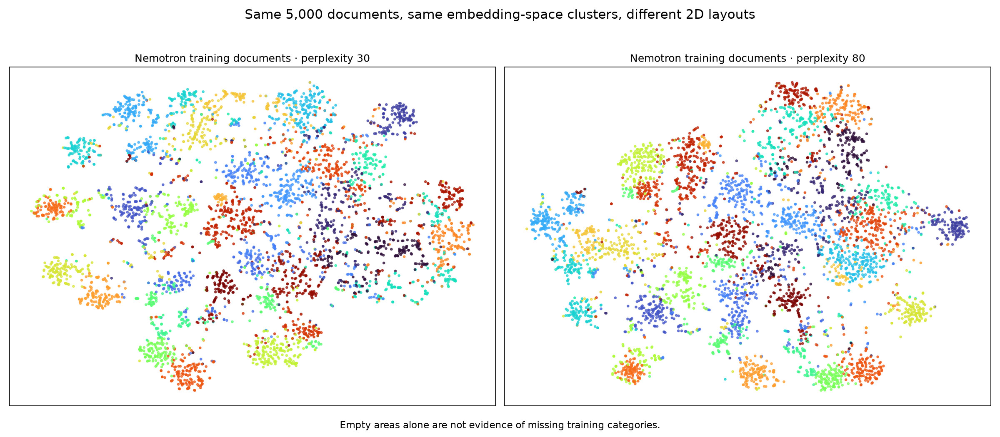
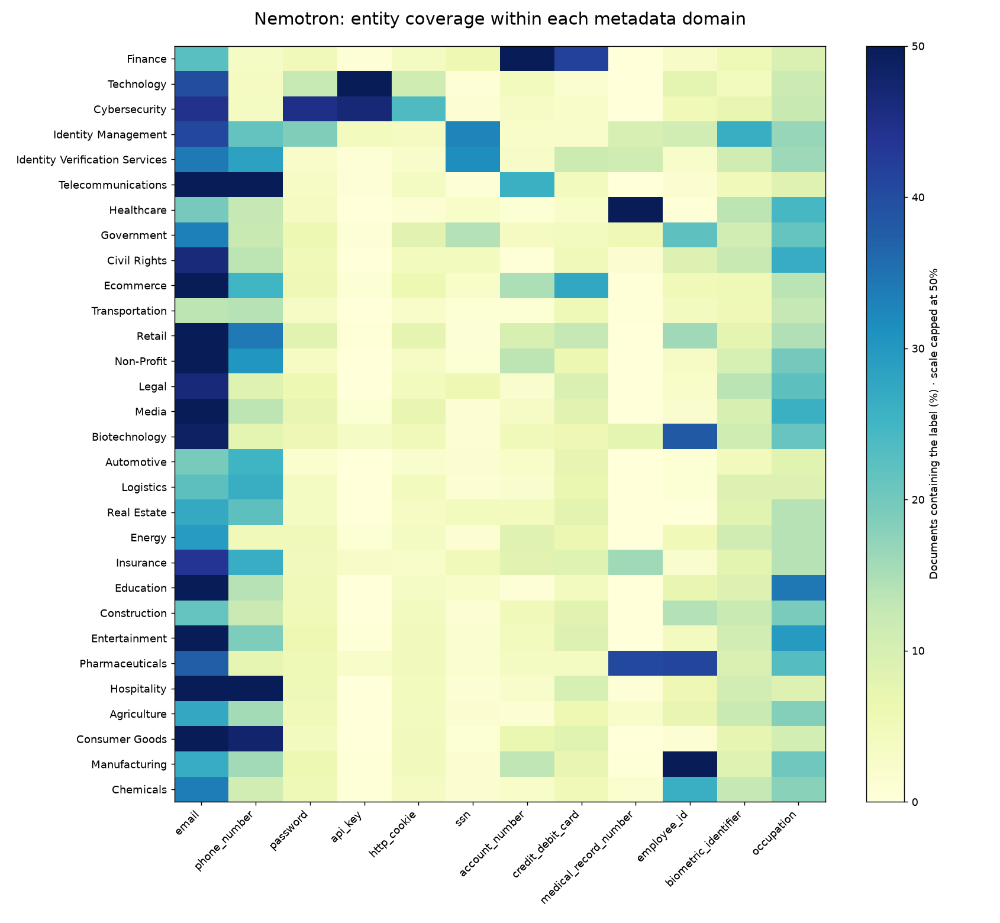

# Training coverage audit: from broad PII to contextual sensitivity

Applied AI governance research by **Harsh Singhal**. Audit completed 16 October 2026; follow-up validation added 21 October 2026.

The audit examined the actual published v2 mixture: **389,521 training rows and 385,562 distinct retained texts**. Artifact hashes matched the recorded manifest. It covered NVIDIA Nemotron-PII, Gravitee, Ai4Privacy, and the locally available project-synthetic component. Evaluation-document text was not used for gap discovery.

## What the corpus covers

Nemotron contributes 99,987 distinct retained texts. Its original training split contains 30 domains, 55 entity types and 1,451 distinct document-type strings. Healthcare, finance, identity records, legal documents, IT operations, logistics, education and other business settings are broadly represented. This describes data coverage, not detection accuracy.

| Finding | Measurement | Interpretation |
|---|---|---|
| Documents with no requested findings | 5,633 unchanged targets, 1.45% of training rows | More benign contrast documents are useful; this is not a claim that label-wise negatives are absent |
| Label-wise negatives | About 79% of unambiguously mapped requested Nemotron labels are absent | Absent-label requests already teach selection |
| Repeated credential values | One JWT-shaped string accounts for 1,169 / 1,566 Nemotron occurrences | Token appearance counts overstate value diversity |
| Private-key blocks | 21 matched blocks in the mixture, all Gravitee; none fully annotated | Presence in text does not establish useful secret-span supervision |
| Explicit placeholders | Five documents match the strict sentinel pattern | A lower-bound lexical signal, not an exhaustive semantic census |
| Long documents | Five retained texts have at least 1,000 whitespace-delimited words; none reaches 2,000 | Long retrieval inputs need dedicated training and evaluation |
| Confidential concepts | Compensation, layoffs, reviews and legal terms occur, but current entity vocabularies do not supervise confidentiality | New policy definitions and evidence annotation are required |
| Legacy target quality | Original audit: 30 malformed/source-recovery failures. Stricter follow-up: 64 rejected targets total | Reject bad targets before replay; the source artifact and original model remain unchanged |

The follow-up validator additionally checks the decoder's two-character minimum, nonblank spans, requested labels and source/tag ambiguity. All 64 rejected targets are Gravitee-derived. The published corpus predates some current converter hardening; this finding does not mean every current rebuild reproduces the historical defects.

## Embedding and clustering method

Every corpus row was embedded locally, including 12 Nemotron texts excluded from the published mixture: 385,574 documents and 518,864 overlapping token windows. The embedding model was `sentence-transformers/all-MiniLM-L6-v2`, revision `1110a243fdf4706b3f48f1d95db1a4f5529b4d41`. Windows used 224 tokens with 32-token overlap. No document tails were silently truncated. Window vectors were normalized; length-weighted document averages were normalized again.

MiniBatchKMeans operated on the original 384-dimensional embeddings: 32 Nemotron groups and 40 full-mixture groups, with three initialization seeds. Central, boundary and random examples informed the cluster descriptions. A second view replaced annotated entity values with `[ENTITY]` in 99,999 distinct raw Nemotron texts.

The t-SNE figures show the same 5,000-document sample with perplexities 30 and 80 after 50-dimensional PCA. **Empty plot areas are not scored as missing categories.** Clusters organize inspection; deployment policy, corpus retrieval and model failures establish generation priorities.

Raw-versus-normalized Nemotron cluster agreement was ARI 0.428. Cross-seed agreement was also partial (Nemotron: 0.572 and 0.494; full mixture: 0.441 and 0.449). These are exploratory partitions, not a stable taxonomy discovered by the model.

Thirty-four scenario queries searched every indexed passage across 17 scenario families. Retrieved examples were inspected to test proposed gaps. A low retrieval score or lack of a top result does not prove absence. Cluster review also found non-English Gravitee records carrying `en` metadata; no complete language census was performed, and the English embedding model limits multilingual conclusions.

## Development probes and next milestone

Twenty-six authored contrastive probes of the pinned v2 model produced four misses, four false positives and one partial boundary. All outputs passed structural/source checks. This adaptive development set was used to design the next experiment and is not its independent test set.

The [credential and compensation milestone](milestones/2026-10-21-credential-context.md) turns these findings into source-grounded synthetic data, explicit policy semantics, disjoint scenario-family splits, validated replay and a measured fine-tuning comparison.

Source attribution and licenses remain in [training-data-and-evaluation.md](training-data-and-evaluation.md). This public note publishes aggregate findings and figures; it does not redistribute the unpublished fourth-source corpus or its excerpts.
