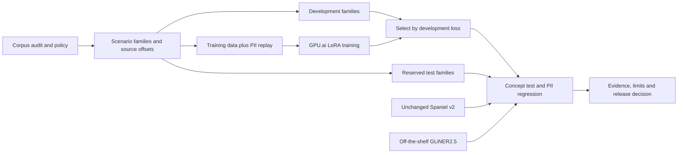

# Milestone: credentials and contextual compensation

**Harsh Singhal · 21 October 2026 · GPU.ai training completed; matched evaluation in progress.**

This milestone asks whether a small local model can distinguish actual credential exposure from benign lookalikes, and private compensation from public salary information. It follows the [coverage audit](../coverage-audit.md). It is a continued LoRA fine-tune of the existing Spaniel v2 checkpoint, with the original checkpoint retained as the baseline.



## Policy before labels

| Requested label | Sensitive examples | Benign examples |
|---|---|---|
| `password` | Actual or purported login passwords, ordinary words used as passphrases, revoked secrets | Unfilled templates, masked values, poem titles and ordinary phrases |
| `api key` | API secrets, bearer/session tokens and credentials in URLs or JSON | Public catalog IDs, token-format explanations and unfilled placeholders |
| `private key` | Complete private-key blocks, including delimiters and padding | Public verification keys and descriptions of key formats |
| `private compensation` | Individual pay, private negotiations and nonpublic compensation budgets, including ranges | Published job advertisements, public market surveys and authorized public pay disclosures |

The policy does not infer secrecy from token entropy or the word “salary.” The same range can be public in a job advertisement and private in an offer negotiation. A private conversation can merely quote a public advertisement; that alone does not make its quoted range private compensation. Conversely, a public survey can be followed by a confidential agreement about an individual's pay.

These are application conventions for this experiment. They do not establish legal confidentiality or a universally correct disclosure policy. Ambiguous cases are explicitly separated for review. Empty model output is not calibrated abstention.

The examples assert public/private status in their text. That is a classification feature, not authenticated disclosure permission. An application must establish permissions through trusted policy or metadata; SPANIEL cannot verify a document's claim that information is public or approved for release.

The concept benchmark requests one of these exact labels at a time. In particular, `private compensation` is different from asking for every `salary` mention. Robustness to alternative names for these new policy concepts, or to many simultaneous labels, is not established by the single-label score. The separate retrieval smoke test exercises a three-label credential request.

## Dataset and splits

The reproducible generator is [sensitive_context/build.py](../../sensitive_context/build.py); authored scenario families are in [scenarios.py](../../sensitive_context/scenarios.py). Values are fictional and non-operational. Private-key bodies exercise the text shape, not cryptographic validity.

| Split | Rows | Scenario families | Role |
|---|---:|---:|---|
| New synthetic training | 5,248 | 34 | Sensitive/benign contrasts, formats, transcripts and long-context dilution |
| Development | 100 | 9 | Checkpoint selection and error investigation |
| Frozen synthetic test | 159 | 17 | Final candidate comparison after checkpoint selection |
| Ambiguity review | 6 | 6 | Missing context; never negative training or binary gold |
| Legacy training replay | 1,536 | Original training texts | 512 validated examples from each public source; no private-source replay |
| Legacy regression evaluation | 300 | Original evaluation texts | Check for loss of established PII extraction behavior |

Substitutions, positive/negative variants and long forms of one family stay in a single split. Exact duplicates are removed, and the training/replay texts are checked against evaluation texts. Template substitutions are correlated examples, not thousands of independent human-authored scenarios. The new labels have not received independent human adjudication.

The new training rows contain 3,221 sensitive and 2,027 benign documents. Categories are not uniformly balanced: deduplication collapses repeated benign templates more than varied sensitive values. For example, the revoked-credential category has 100 sensitive rows but only four distinct benign rows; access tokens have 200 and five. The [coverage counts](../../reports/context-coverage.json) expose this limitation. More independently authored benign scenarios remain valuable even if this candidate passes the small test. The separate legacy replay accounts for 22.6% of training rows.

Transcript cases include informal number expressions, speaker turns, delayed context, corrections, missing punctuation, spelling errors and line wrapping. **These are simulated text transcripts. No audio, real ASR system or real transcription corpus is evaluated.**

Long variants insert 250 or 900 words of generated public-information filler, with the relevant evidence at the beginning, middle or end. This measures controlled dilution; it is not equivalent to a diverse enterprise-document benchmark.

Annotations store exact source offsets. Companion context ranges describe surrounding evidence, including earlier messages; those ranges are not independent gold rationales. The current model still emits separate, non-overlapping contiguous spans and does not output linked evidence groups.

Coverage remains narrow within some credential categories. Private-key examples use short synthetic `BEGIN PRIVATE KEY` blocks; other delimiters, encrypted keys and full-length real key formats are not validated. Password hashes, encoded secret payloads, partially masked values, Unicode obfuscation and provider-specific credential formats need additional scenarios. The one literal `CHANGEME` password family deduplicates to one positive and one negative example, which is not broad evidence about weak or placeholder-looking actual passwords. Aggregate credential scores must be read alongside per-family results.

## Training and verification

The pinned base is `Harsh/qwen3-0.6b-pii-sft-v2` at `a58063469be8c7b929016d944d8d6d1545bc70a0`. The candidate uses rank-16 LoRA on attention and feed-forward projections, alpha 32, dropout 0.05, two epochs, learning rate `5e-5`, effective batch size 16, bf16 and a 4,096-token maximum.

The tokenizer preflight covers all **6,784 training rows** and the development set. Its maximum sequence is **2,201 tokens**, so nothing is truncated. Prompt tokens have loss mask `-100`; the assistant's tagged completion and chat ending receive loss. The original published training file is never edited.

Checkpoint selection uses development completion loss only. Baseline and candidate then use identical constrained decoding on the same GPU. The [protocol](../../experiments/credential-context-protocol.json) records the proposed screening thresholds and limitations before final test measurements.

Training completed on a GPU.ai RTX 4090 with 24 GB of memory in 4,797.8 seconds, about 80 minutes. Of 848 optimizer steps across two epochs, **step 424 (epoch one)** was selected: development completion loss was 0.033813 after epoch one and 0.043643 after epoch two. More training did not improve this selection measure. The selected adapter has 10,092,544 trainable parameters and SHA-256 `8e4e99c32a5051d34d1a1d41ca73e52b00b59eef8e39453c24d92fe2b1d53b85`.

Completion loss includes copied source tokens as well as tags. It is the frozen selection rule for this run, not a direct measure of missed disclosures or benign interruptions. Future experiments can predeclare development selection by those application metrics; this run does not change its rule after seeing results.

The [run manifest](../../reports/credential-context/run_manifest.json) and [training history](../../reports/credential-context/training_history.json) record the completed run. The training-stage manifest deliberately retains `trained_not_evaluated`; evaluation and release decisions are separate artifacts. The initial environment failed before optimization because a C compiler was missing. Installing the image's compiler prerequisites resolved that bootstrap error without changing the recipe.

The first experiment combines targeted augmentation and replay. It does not isolate either component or establish LoRA superiority over full fine-tuning. The [GLiNER2.5 comparison](../gliner-context-baseline.md) is an off-the-shelf baseline; an equal-data architecture comparison requires additional controlled runs.

## Application checks on the selected adapter

The final selected weights were also exercised through the actual local retrieval tool on Apple MPS with bf16. These are small integration checks, separate from the reserved synthetic benchmark and GPU comparison.

| Suite | Expectations met | Sensitive documents released | Benign false blocks | Unexpected errors |
|---|---:|---:|---:|---:|
| [Existing retrieval examples](../../reports/credential-context/retrieval-existing-smoke.json) | 14/15 | 0 | 1 | 0 |
| [New contextual examples](../../reports/credential-context/retrieval-context-smoke.json) | 7/11 scored; one unscored | 2 | 2 | 0 |

The contextual suite missed a private negotiation and an actual password equal to `CHANGEME`. It blocked a public job range and an unfilled template. The older suite's failure was also an unfilled placeholder. Requested credential labels differ between the suites and the single-label benchmark, so these counts are not interchangeable.

The contextual smoke ran on the epoch-one artifact before training ended; its weights were later verified byte-for-byte identical to the selected final adapter. Checkpoint selection still used development completion loss only. These observed failures rule out presenting this artifact as reliable disclosure prevention merely because its output passes source validation.

In the [six missing-context demonstrations](../../reports/credential-context/ambiguity-review.json), the tool blocked three texts and released three. These cases have no asserted binary gold, so neither count is an accuracy score. They confirm a separate product limitation: the tool does not request clarification or route semantically uncertain text for review. A complete source-preserving annotation can still express an unsupported judgment about sensitivity.

## What the observed failures imply for the next data revision

These are next-iteration priorities, not claims that another training run has already fixed the failures.

| Evidence from this iteration | Data revision to investigate | Separate check needed |
|---|---|---|
| `CHANGEME` used as an actual password was missed; unfilled templates were blocked | Independently worded positive and negative contexts for the same low-entropy values, including indirect references and multiple requested labels | Hold out both scenario families and values; report literal-password misses separately from placeholder false blocks |
| Ordinary-word handover passphrases were missed in development | More ways of expressing authentication use, with benign titles, reminders and ordinary phrases using identical words | Contrast actual access instructions with noncredential uses, including delayed speaker turns |
| Public job range falsely blocked; private negotiation released | Separate the amount from its role: public quotation, individual agreement, confidential range, budget and authorized publication | Include mixed public/private paragraphs and repeated identical amounts; require correct source occurrence |
| Development private-key detections excluded delimiters or padding | Consistent complete-block annotation across independently reviewed key shapes and formats | Exact-boundary scoring in addition to document withholding; no claim of cryptographic validation |
| Three releases and three blocks on missing-context cases | Keep unresolved context separate from binary negatives; design a review signal with independent gold | Measure review coverage and error costs; an empty span list is not abstention |

Deduplicating 5,248 rows still leaves only 34 training families, and some benign categories collapse to very few distinct contexts. Increasing value substitutions alone would not resolve that limitation. Once observed test failures inform new training, this test becomes development evidence for that next iteration; a new untouched scenario-family test is required. [The research roadmap](../research-roadmap.md) separates independent annotation, equal-data architecture comparisons and real transcript evaluation from this completed training experiment.

## Reproduce

```bash
python -m sensitive_context.build --out context-data
python -m sensitive_context.replay \
  --legacy-train sft_data_v2/sft_train_v2.jsonl \
  --out context-data/replay.jsonl
```

The replay command validates the complete historical mixture, records rejected row indices/hashes, and samples only public sources. The exact replay hash depends on the exact original mixture; the public three-source rebuild remains a different artifact. To reproduce the 300-document regression, supply the first 300 rows of the recorded `sft_data/sft_eval.jsonl` as `context-data/legacy-eval.jsonl`.

On the prepared GPU.ai CUDA instance, run:

```bash
bash experiments/run_credential_context.sh
```

The runner assumes an available CUDA PyTorch installation, a C compiler and Python development headers (Ubuntu packages `build-essential` and `python3-dev`; needed by the image's Triton kernels). It creates a virtual environment, installs pinned experiment dependencies, runs regression tests, trains an adapter and writes separate baseline/candidate reports. No API keys or Hugging Face write credentials are uploaded to the training instance. Provisioning, artifact collection and instance termination are managed separately.

The published run's independent evaluation jobs shared the same GPU concurrently after training to use idle capacity. Their data, weights, evaluator and decoding were unchanged. Per-case elapsed times therefore include shared-resource contention and must not be used for latency or throughput comparisons. The reproduction runner above executes the same evaluations sequentially.

## What qualifies as progress

Report sensitive-document recall, benign false blocks, inspection failures, exact typed span F1 and correct contrast-pair decisions separately. A structurally valid tag is not necessarily correct. A parser failure must not become an all-clear result.

Credentials are the first area of deeper investment. Compensation is a deliberately narrower experimental concept. Legal strategy, layoffs, performance reviews and other confidentiality concepts remain unvalidated research targets. See the [capability record](../../CAPABILITIES.md) for the distinction between measured and best-effort behavior.
